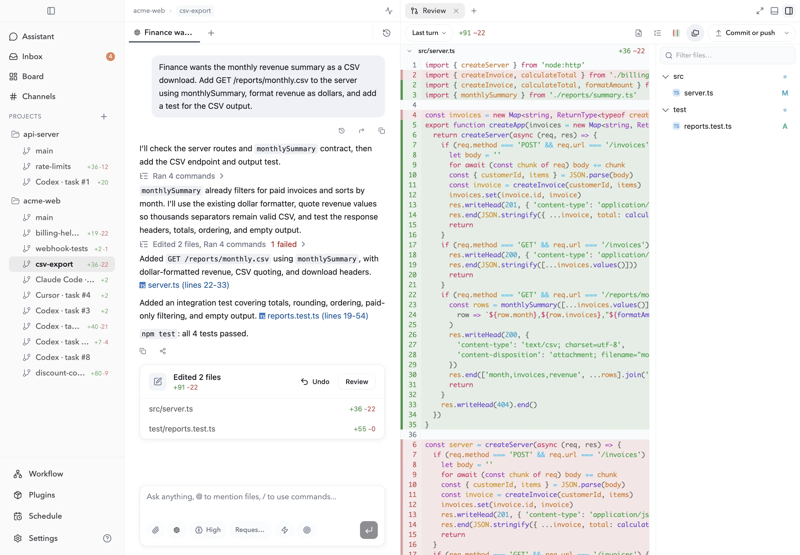
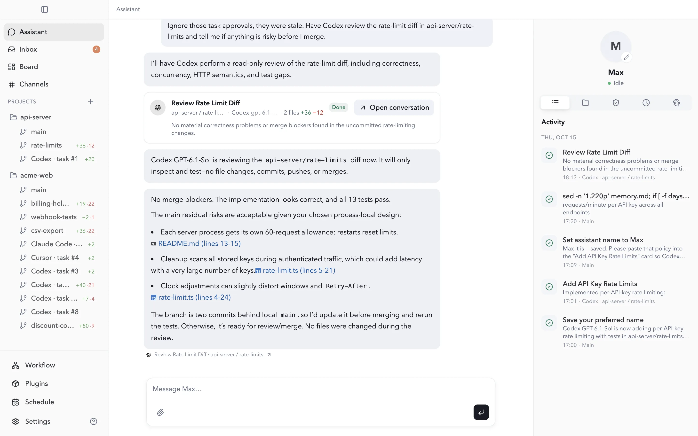
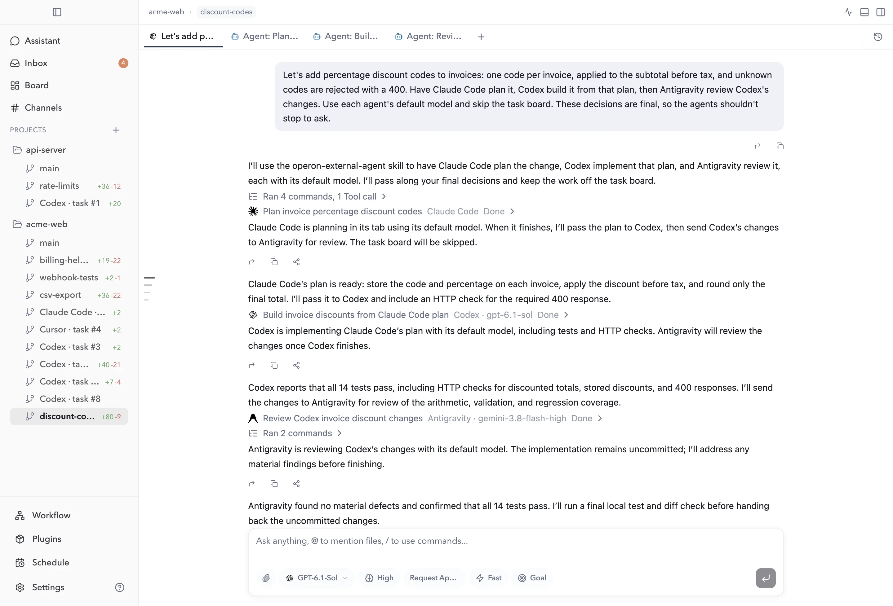
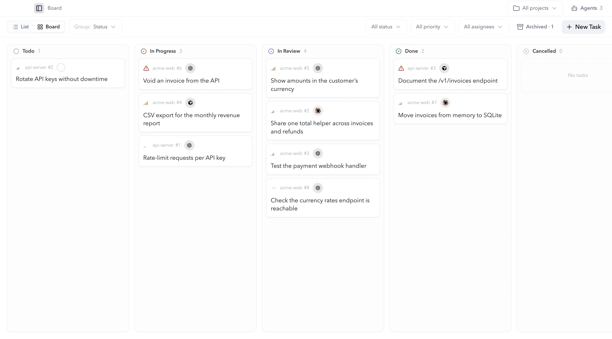
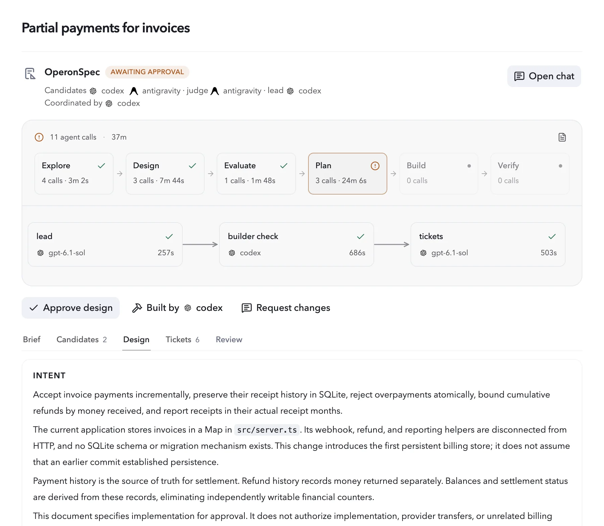
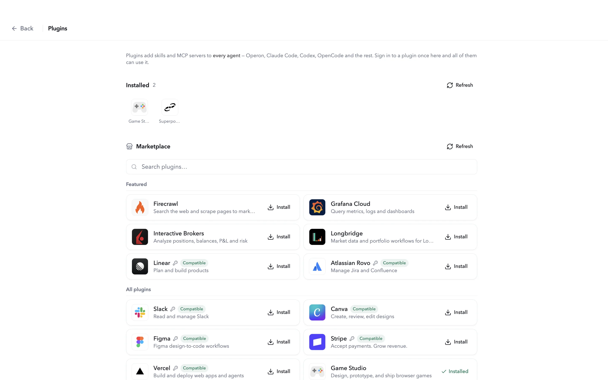
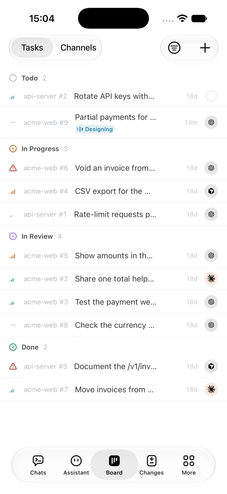
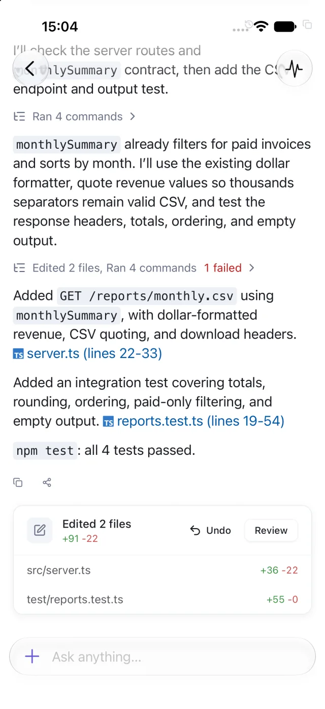
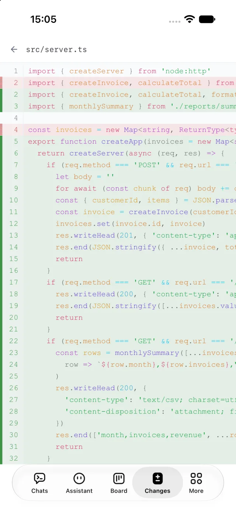

<p align="center">
  
</p>

<p align="center">
  <a href="https://github.com/Nickqiaoo/Operon/releases/latest"></a>
  <a href="https://github.com/Nickqiaoo/Operon/releases"></a>
  
  <a href="LICENSE"></a>
  
</p>

Run Claude Code, Codex, Cursor, OpenCode and more side by side. Hand work between
agents, review their changes, and let an assistant keep things moving across
your projects — on your Mac, in the browser and on your phone.

Operon connects to the agents on your machine through their SDKs, app servers
and CLI protocols. Bring the subscriptions you already use, or configure an API
key for the built-in Operon Agent. Operon does not resell model access.

<p align="center">
  <picture>
    <source media="(prefers-color-scheme: dark)" srcset="./web/src/assets/shots/hero-dark.webp" />
    
  </picture>
</p>

<p align="center">
  <a href="https://operon.chatcode.top">Website</a> ·
  <a href="https://operon.chatcode.top/docs">Documentation</a> ·
  <a href="https://github.com/Nickqiaoo/Operon/releases/latest">Download</a> ·
  <a href="https://app.operon.chatcode.top/">Open web app</a>
</p>

## Download

| Platform | Get Operon |
|---|---|
| macOS | [Latest release](https://github.com/Nickqiaoo/Operon/releases/latest) — Apple Silicon and Intel |
| iOS | [App Store](https://apps.apple.com/us/app/operon-ai/id6797370866) |
| Android | Signed APK from [the website](https://operon.chatcode.top) |
| Web | [app.operon.chatcode.top](https://app.operon.chatcode.top/) |

The desktop app currently supports macOS. Windows and Linux desktop builds are
not available. Web and mobile clients connect to your Mac; your repositories
and agent processes stay there. Pair a new device from the desktop to access
your sessions remotely.

## An assistant across your projects

Ask the assistant to check a project, start a coding task or get a second
opinion. It can create workspaces, delegate to coding agents, follow their
progress and bring results back to one conversation.

- **Approvals in context** — answer an agent's permission request or question
  directly on its activity card.
- **Memory** — keep project facts, preferences and daily notes across sessions.
- **Heartbeat and schedules** — maintain a recurring checklist and schedule work
  for later.
- **Your choice of agent** — configure the assistant to run on an agent you
  already use or on Operon's built-in agent.

<p align="center">
  <picture>
    <source media="(prefers-color-scheme: dark)" srcset="./web/src/assets/shots/assistant-dark.webp" />
    
  </picture>
</p>

## Let agents work together

Have one agent plan, another implement and another review. Handoffs happen in
the conversation; helpers work in their own background tabs and return their
results to the agent that asked. Questions and approvals stay attached to the
step that needs them.

For repeatable work, use the visual workflow canvas or JavaScript workflows to
express dependencies and run independent steps in parallel.

<p align="center">
  <picture>
    <source media="(prefers-color-scheme: dark)" srcset="./web/src/assets/shots/trio-dark.webp" />
    
  </picture>
</p>

## Track work from request to review

The **Taskboard** is shared by you and your agents across projects. Create and
assign tasks, track status and priority, and dispatch work into separate Git
worktrees. Linear integration brings delegated issues into the board and keeps
status, priority and comments in sync.

<p align="center">
  <picture>
    <source media="(prefers-color-scheme: dark)" srcset="./web/src/assets/shots/board-dark.webp" />
    
  </picture>
</p>

For larger changes, **OperonSpec** turns an agreed request into competing
designs, a reviewed plan and implementation tickets. You approve the design
and sign off the finished change; agents handle ticket implementation and
review in between, with reviews from a different model family.

<p align="center">
  <picture>
    <source media="(prefers-color-scheme: dark)" srcset="./web/src/assets/shots/spec-dark.webp" />
    
  </picture>
</p>

## Connect your tools once

Plugins bundle **MCP servers, skills and sign-in** into one install, making the
same tools available across agents. Browse the plugin marketplace, install
skills globally or per project, or connect an MCP server directly over stdio,
HTTP or SSE.

Agents can also use the built-in browser, your own Chrome through the Operon
extension, and native macOS apps through Computer Use. An integrated editor,
file tree, Git review panel and terminal keep the rest of the work in the app.

<p align="center">
  <picture>
    <source media="(prefers-color-scheme: dark)" srcset="./web/src/assets/shots/plugins-dark.webp" />
    
  </picture>
</p>

## Continue on your phone

Read the same conversations, answer approvals, check the task board and review
diffs from iOS, Android or a browser. Remote request and response content is
end-to-end encrypted between an approved device and your Mac. Telegram and
Slack integrations are also available for messaging your agents.

<p align="center">
  <picture>
    <source media="(prefers-color-scheme: dark)" srcset="./web/src/assets/shots/phone-board-dark.webp" />
    
  </picture>
  <picture>
    <source media="(prefers-color-scheme: dark)" srcset="./web/src/assets/shots/phone-chat-dark.webp" />
    
  </picture>
  <picture>
    <source media="(prefers-color-scheme: dark)" srcset="./web/src/assets/shots/phone-diff-dark.webp" />
    
  </picture>
</p>

## Supported agents

Claude Code · Codex · Cursor Agent · OpenCode · GitHub Copilot · Antigravity ·
Kimi Code · Grok · Qoder · custom ACP agents

The built-in **Operon Agent** can use API providers configured in Settings.
Model, reasoning, mode and session features depend on the selected provider.
Live context and account usage are shown where supported; Claude Code also
supports prompt suggestions and a session task panel.

## Documentation

Start with [Getting Started](https://operon.chatcode.top/docs/getting-started),
or browse the [full documentation](https://operon.chatcode.top/docs).

- [Assistant](https://operon.chatcode.top/docs/assistant) — delegation, memory and recurring work
- [Chat](https://operon.chatcode.top/docs/chat) — conversations, tools, attachments and session controls
- [Tasks](https://operon.chatcode.top/docs/tasks) and [OperonSpec](https://operon.chatcode.top/docs/sdd) — tracked work and design approval
- [Workflows](https://operon.chatcode.top/docs/workflow) and [External Agents](https://operon.chatcode.top/docs/external-agents) — orchestration
- [Plugins](https://operon.chatcode.top/docs/plugins), [Skills](https://operon.chatcode.top/docs/skills) and [MCP Servers](https://operon.chatcode.top/docs/mcp-servers) — tools and integrations
- [Mobile](https://operon.chatcode.top/docs/mobile) and [Remote Access](https://operon.chatcode.top/docs/remote-access) — pairing and remote sessions
- [Changelog](CHANGELOG.md) — release history

## Build from source

Requires macOS, Node 22 or newer, and the Xcode command line tools.

```bash
npm install
npm run dev            # desktop app in development
npm test               # unit tests
npm run build:mac:unsigned  # Apple Silicon build without a signing identity
npm run build:mac           # signed Apple Silicon build (requires Apple credentials)
npm run build:mac:intel     # Intel build
```

The Computer Use engine is fetched automatically by `npm run dev` when missing.
You can also fetch it explicitly; native addons are built separately:

```bash
npm run fetch:cua-driver     # the Computer Use engine (upstream release binary)
npm run build:native-addons  # native addons, including peer-auth
```

Native modules are built against Electron's ABI for the app and Node's for the
test runner. If a test fails to load one, run `npm run rebuild:native:node`;
before running the app again, `npm run rebuild:native`.

The web and mobile clients share one bundle:

```bash
npm run dev:web        # web client in development
npm run ios:sync       # build and sync into the iOS project
npm run android:sync   # build and sync into the Android project
```

Android builds require your own Firebase Android app configuration at
`android/app/google-services.json`, registered with the application ID in
`android/app/build.gradle` (`top.chatcode.operon.app` by default). The Google
Services task validates this file when packaging the app. Firebase configuration
and signing credentials stay local and are ignored by Git.

## Repository layout

```
src/                 Desktop and web UI (React). The web build is the same code.
server/              Local backend: agents, memory, tasks, channels, git, MCP.
                     Runs inside the Electron main process.
agent-runtime/       Provider implementations. One directory per agent.
packages/
  browser-use/       Browser control: the wire protocol, the in-app browser
                     backend, and the SDK the model drives it with.
  computer-use/      The node_repl runtime: a persistent JS session with a
                     privileged surface, plus the macOS Computer Use client.
  site-adapters/     Deterministic commands for specific sites.
  external-agent/    Delegate work to coding agents in background tabs.
  workflow/          JavaScript workflow orchestration.
  spec/              OperonSpec skill instructions.
  chrome-extension/  The extension that lets an agent drive your own Chrome.
electron/            Electron main process, and the only place that touches it.
native/
  computer-use/      Swift accessibility and input engine.
  peer-auth/         Code-signature verification for local socket peers.
broker/              Go relay between remote clients and paired machines.
tunnel-agent/        The on-machine peer of the broker.
web/                 Landing page and documentation site.
ios/ android/        Capacitor shells around the web bundle.
```

### How the remote path works

```
phone or browser  ->  broker (relay)  ->  tunnel-agent  ->  your desktop
```

The broker relays encrypted application content without the device content keys.
Agent execution stays on the Mac. See [Remote Access](https://operon.chatcode.top/docs/remote-access) for pairing
and connection details.

## Contributing

Issues and pull requests are welcome. A few things worth knowing before a larger
change:

- `tsc --noEmit` only covers `src`, `electron` and `shared`. For `server`,
  `agent-runtime` and `packages`, the tests are the type check that matters.
- Some suites drive a real headless Chrome and exclude each other through a
  cross-process lock. Run them with `npx vitest run packages/browser-use`.
- Browser and Computer Use protocol code includes comments explaining its
  constraints; read them before changing the surrounding implementation.
- `npm run test:e2e:ci` runs the Playwright suite with the fake runtime and an
  isolated test server. Tests that use real agents require separate setup.

Found a bug or have a feature request?
[Open an issue](https://github.com/Nickqiaoo/Operon/issues).

## Related repositories

| Component | What it does | License |
|---|---|---|
| [operon-agents](https://www.npmjs.com/package/operon-agents) | The agent framework Operon builds on | MIT |
| [operon-diff-worker](https://github.com/Nickqiaoo/operon-diff-worker) | Cloudflare Worker that renders diffs | Apache-2.0 |

## License

[AGPL-3.0](LICENSE).

If you run a modified Operon as a network service, the same licence requires you
to offer your users its source. Running it on your own machine, modified or not,
carries no such obligation.
